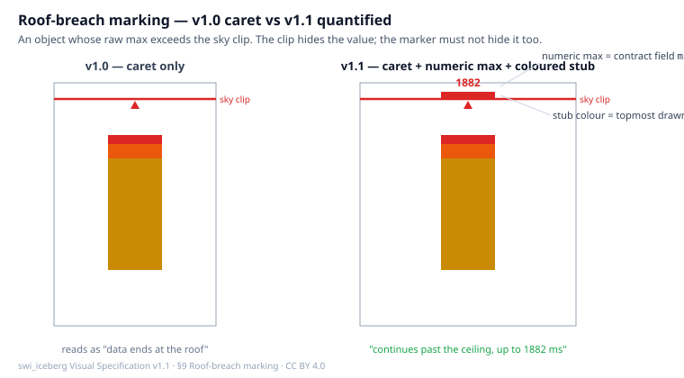

# swi_iceberg — Visual Specification

## A Normative Rendering and Interaction Contract for the Iceberg Fleet

**Design specification — version 1.2.2 (display model)**

**Introduced by:** Sven Pauline
**Year:** 2026
**Copyright:** © 2026 Sven Pauline. Associated with Sheer Will Industry (SWI).
**License:** Creative Commons Attribution 4.0 International (CC BY 4.0)
**Status:** Canonical rendering / interaction specification (language-agnostic, publishable)
**Companion document:** [specification_swi_iceberg.md](specification_swi_iceberg.md) — the
**statistical model** (version 1.1). This document is the **display model**; the two
together are the complete swi_iceberg specification.
**Software usage:** [docs/swi_iceberg_User_Manual.md](docs/swi_iceberg_User_Manual.md) — how to
drive the package; not normative for rendering.

---

## 0. Scope, and why this document exists

The swi_iceberg is a **visual** specification: several of its "statistics" exist only
because a picture needs them. A band's *height* is the observed value range
(`band_lo`/`band_hi`) purely so the silhouette can carry occupied range; the
`topping`/`bottoming` counts exist purely so clipped tails can be drawn as caps. In a
mark like this, the statistical model and the rendering cannot be pulled fully apart.

Rather than pretend they separate, version 1.1 splits the specification along the seam
that *does* hold — the **handoff contract** — into three layers:

| Layer | Owns | Document | Mutability at v1.1 |
|---|---|---|---|
| **Statistical core** | median, MADN, band partition, population conservation, the ±3 MADN envelope, tail retention | [specification_swi_iceberg.md](specification_swi_iceberg.md) | **Frozen** — no number changes |
| **Handoff contract** | the `to_json` payload schema (the fields a renderer is allowed to read) | shared; §2 here | **Additive** — gains `min`, `max` |
| **Display model** | geometry, colour, clipping, roof marking, overshoot, background, interaction | **this document** | **New** — relocated + v1.1 additions |

This document **absorbs the visual sections** that lived in the statistical spec at v1.0
(§5 width consequence, §6 height, §7 display clipping, §8 medians, §9 colour, §10
background, §11 encoding table) and **adds the v1.1 display requirements** introduced by
the SCADA fleet view. A conforming renderer implements this document; a conforming
statistician implements the statistical document; the `to_json` payload is the only thing
they share.

### 0.1 Normative language

The words **SHALL**, **SHOULD**, and **MAY** carry their usual meaning. A **conforming
renderer** is one that satisfies every unqualified **SHALL** below. Rendering choices
marked **MAY** are optional affordances; the reference harness (`devices-svg.ts`)
implements all **SHALL** items and most **MAY** items.

---

## 1. Coordinate system and the shared axis

- **x-position** encodes the **object** — one category or entity in the fleet. The mark is
  domain-agnostic: an object may be a device, a cohort, a region, a wealth bracket, a
  service, or anything else that carries a distribution of a measured quantity. Objects are
  laid out left-to-right in a stable, meaningful order whose sort key is chosen by the
  application, not by this specification.
- **y-position** encodes the **absolute measured value** (milliseconds, currency, counts —
  whatever the quantity is) on **one axis shared by the whole fleet**. Every swi_iceberg
  floats at its own `median ± z·MADN` on that common scale (statistical §3.4, §14.6).
- The renderer SHALL NOT give each object its own vertical scale; the comparison the
  fleet exists to enable is destroyed the moment axes differ.

---

## 2. The handoff contract (v1.1)

The package's `to_json(glyph)` is the canonical payload — *"statistics only; no pixels."*
A conforming renderer SHALL read its picture from these fields and SHALL NOT recompute a
statistic that the payload already carries (recomputing invites a second implementation
of the model to drift from the first).

Fields at v1.1:

| Field | Meaning |
|---|---|
| `mode` | `"normal"` or `"collapsed"` (zero MADN) |
| `n` | sample count |
| `median`, `madn` | robust center and scale |
| `resolution`, `z_min`, `z_max` | band width and envelope in MADN units |
| `lower`, `upper` | absolute ±envelope (`median + z_min·madn`, `median + z_max·madn`) |
| `edges` | band edges in MADN units, length = bands + 1 |
| `population` | per-band counts, low → high — the **width** encoding |
| `normalized` | `population / n` |
| `band_lo`, `band_hi` | observed value range inside each band, `null` when empty — the **height** encoding |
| `topping`, `bottoming` | retained counts beyond `+z_max` / below `z_min` |
| `value` | collapsed-mode single value (equals `median`) |
| **`min`, `max`** | **NEW v1.1** — the object's raw sample extremes, retained so the renderer can detect a shoot-through the pooled summary cannot express (§9) |
| `spec_version` | the **handoff-contract (schema)** edition the payload conforms to (`"1.1"`) — bumps only when a data field changes |
| `display_version` | the **display-model** edition the payload is tagged for (`"1.2.2"`) — bumps when a rendering rule changes; a renderer pins the edition it implements |

> **`mode: "normal"` is not the Gaussian normal distribution.** "Normal" here means only
> the general case — a spread with a non-zero MADN — as opposed to `"collapsed"` (every
> sample identical, zero MADN). Nothing in the swi_iceberg math assumes any distribution:
> the center is the median and the scale is MADN (the normalized median absolute deviation).
> The `±1`, `±2`, `±3` band edges are **MADN units, not Gaussian standard deviations and not
> probability intervals**. MADN is *compared* to a Gaussian only because a reader already
> knows what "one sigma / three sigma" looks like; the bands stay honest for skewed,
> heavy-tailed, and multi-modal data (statistical §3.3).

**v1.1 change.** `min` and `max` move from a caller-side bolt-on into the payload.
They are trivially `min(values)` / `max(values)`; adding them changes no existing
statistic, but it lets every consumer drop its own recomputation and lets the roof
marker (§9) be defined purely from the contract.

`spec_version` is a **lockstep guard**: a renderer or bridge that pins a version SHALL
refuse to draw a payload whose `spec_version` disagrees, rather than silently rendering a
contract it does not understand.

**Two version axes.** `spec_version` guards the *schema* — whether a renderer can read the
fields at all. `display_version` guards the *drawing rules* — whether the renderer's
geometry, colour, roof marking, curve annotation and overshoot behaviour match the edition
the data was produced for. They move independently: a display-rule change bumps
`display_version` and leaves `spec_version` (and the frozen statistics) untouched. A
conforming renderer pins **both** and refuses — or visibly warns on — a payload whose
`display_version` differs from the edition it implements, so a rendering change can never
be silently drawn by a stale interpretation. This is why the display model is patched
(1.1 → 1.1.1) here with no contract or data change.

---

## 3. Band geometry (relocated from statistical §5–§6)

Each object is a vertical stack of equal-width MADN bands (default six over ±3).

- **Width** of a band SHALL be its normalized population `population[k] / n`, drawn
  centered on the object's x-coordinate so width changes never shift the visual center.
- **Height** of a band SHALL span the **observed value range** of the samples inside it:
  from `band_lo[k]` to `band_hi[k]`, mapped through the shared y-scale. The band is *not*
  a fixed theoretical block.
- An **empty band** (`population[k] == 0`, `band_lo`/`band_hi` null) SHALL NOT be drawn.
  This is the sole intended source of a vertical **gap** between two adjacent bands: a gap
  means no sample's value falls in that range. A renderer MAY render an explicit gap
  marker instead of blank space, but blank is conforming.
- Fallback: if a band is non-empty but its observed range is unavailable, a renderer MAY
  fall back to the theoretical edges `median + edges[k]·madn` … `median + edges[k+1]·madn`.
  Under the reference statistics this never triggers (a non-empty band always has a real
  observed range), so it is a guard, not a behaviour.

**Reading a gap.** Because height is the observed range, the silhouette distinguishes
"clustered data with deserts between clusters" from "continuous spread." A renderer SHALL
NOT invent fill across an empty band to make a column look solid.

---

## 4. Colour (relocated from statistical §9)

A diverging green → amber → orange → red ramp keyed to band position, low (fast) to high
(slow). The reference palette, bottom-to-top:

```
#166534  #15803d  #65a30d  #ca8a04  #ea580c  #dc2626
 -3σ̂     -2σ̂      -1σ̂      +1σ̂      +2σ̂      +3σ̂
```

Tail caps use dedicated deep tones: `#14532d` (seat pad), `#7f1d1d` (topping).

**The palette is open.** The hues above are the reference choice; the *profiling* of each
zone — where a colour starts and ends, how many steps there are, and the exact values — is a
branding and accessibility decision, not part of the statistics. Any conforming renderer MAY
retune the ramp and the tail-cap tones to its own palette, provided the bottom-to-top
ordering still reads as low-to-high and the redundancy invariant below holds.

**Redundancy invariant:** colour SHALL never be the sole carrier of meaning — a band's
vertical position encodes the same deviation, so the mark stays readable in grayscale and
to a colour-blind reader.

---

## 5. Medians (relocated from statistical §8)

- **Object median**: a **solid** horizontal rule across the object footprint. Not a band;
  its width encodes no population.
- **Global (pooled) median**: a **dashed** horizontal line spanning the plot, with its
  numeric reading attached to the matching axis tick.

---

## 6. Display clipping and the tail caps (relocated from statistical §7)

The body is bounded by the ±3 MADN envelope. Observations beyond it do **not** stretch the
body; they are retained as **topping** (above, the high tail) and **seat pad** (below, the
low tail; the handoff field is `bottoming`).

Terminology used throughout these documents and the code comments: **topping** = the high
tail beyond +3 MADN; **seat pad** = the low tail beyond −3 MADN (field `bottoming`);
**roof carpet** = the topping's continuation drawn above the roof when the raw maximum
passes the pooled clip (§9); **basement carpet** = the seat pad's continuation drawn
below the basement when the raw minimum passes its pooled clip (§9).

- Each tail SHALL be drawn as a **fixed symbolic-height cap** anchored at its own ±3
  boundary — the seat pad at the −3 boundary (below the body), the topping at the +3
  boundary (above the body). The reference uses a 4-pixel cap just outside the envelope.
  Its vertical thickness is a rendering parameter and encodes nothing.
- **Width is the one shared encoding for every population region.** Topping, seat pad and
  both carpets use exactly the same width scale as the six body bands (`count / n` on the
  shared reference width). The ONLY difference between a body band and a tail / carpet region
  is **height**: a body band's height is the observed value range of its samples, while a
  tail / carpet region's height is fixed and symbolic. A wide topping or seat pad therefore
  means "a large fraction of this object's samples sit far above / below the centre" without
  any single extreme value destroying the vertical scale.
- A tail region with zero population MAY be omitted.

This is **display clipping**, not deletion and not winsorization: the samples are neither
removed nor replaced by boundary values; they move into a width-encoded cap.

---

## 7. The roof/basement clip (v1.2)

The **pooled** background and the unzoomed **visible value axis** use a paired roof and
basement. Both sides use the same positive pooled reference magnitude `S` and the same
`clipMultiple`; a negative sample does not disable either clip:

```
S = |pooled_median|, if pooled_median ≠ 0
    pooled_MADN, if pooled_median = 0 and pooled_MADN > 0
    max(|pooled_min|, |pooled_max|), otherwise
roof     = min( clipMultiple × S, pooled_max )
basement = max(−clipMultiple × S, pooled_min )
```

- **Default and control.** The display-model default is `clipMultiple = 3`; a renderer MAY
  expose a positive multiplier control and MAY choose an explicitly documented application
  default such as SCADA's 2. Raising it moves both clip thresholds away from zero until
  each reaches its own observed extreme. The control SHALL affect both sides together.
- **Signed domains.** Negative measurements are valid. The pooled median may be negative
  or zero, so its absolute magnitude sets the paired thresholds. At exactly zero median,
  the existing pooled MADN supplies the reference; if MADN is also zero, the largest raw
  magnitude is the last nonzero fallback. These are display calculations from existing
  handoff fields, not new statistics. If every pooled value is zero, `roof = basement = 0`:
  show the collapsed zero line in a symmetric non-data viewport, with no breach markers.
  Any other `roof = basement` constant-value case likewise receives a small non-data
  viewport centered on that value; it is not evidence of additional sample range.
- **Independent observed caps.** The formulas are mirrored, but the final bounds need not
  have equal magnitude: one side may reach its pooled extreme first. A renderer SHALL NOT
  substitute the full raw range merely because `pooled_min < 0`.
- The unzoomed numeric axis SHALL run from **basement to roof**, not to padded values or
  the union of object envelopes. Reserve pixel margins *outside* the axis for breach
  markers and labels (§9). Zooming and panning MAY show a narrower value window; their
  full-domain limit is the paired clip. A sample outside either bound gets a breach marker,
  not extra numeric axis space.

---

## 8. Overlay curves and values beyond the visible range (v1.2.2)

The optional median, maximum and minimum curves connect the respective statistics
of the visible objects in display order. Each point belongs to one object; the
space between objects is not a continuous time series and does not contain additional
observations.

1. Each curve SHALL use a **step-after** path. Starting at an object's actual
   value, draw a horizontal segment to the next object's x-position, then a
   vertical segment to that object's actual value. Equal adjacent values therefore
   form a flat segment; a curve changes value only at an object position. No curve
   SHALL add an interpolated peak or dip between objects.
2. Each point SHALL use the **unclamped** value-to-y mapping. A value outside the
   visible window takes the step beyond the roof or basement; the line SHALL NOT
   be pinned to an axis edge. Clip horizontally to the object plotting extent while
   leaving both value ends open.
3. A median outside the visible window SHALL be marked with a dot at its true
   position. A renderer MAY show its numeric value; labels that would overlap
   SHOULD be staggered or deferred to a tooltip.
4. The maximum and minimum curves SHALL NOT add duplicate breach values or dots:
   the object's raw extrema are already marked and labelled under §9.

A run of consecutive median values above the roof stays above the roof between
those objects. When the next object's value is below the roof, the line returns at
that object's position; if the last value is outside the window, the end remains
open. The same rule applies at the basement and to maximum and minimum curves.

---

## 9. Roof and basement breach marking (v1.2)

An object whose **raw maximum exceeds the roof clip** has data the clipped body cannot
show. The renderer SHALL mark it, and — new at v1.1 — **quantify** it.

- **v1.0:** a red caret at the roof over the object's column (a 2-pixel tick when the slot
  is too narrow for a caret). The reference draws this even in curves-only mode, because it
  describes the data, not the glyph.
- **v1.1 additions:**
  1. A **numeric label** of the object's raw `max` above the roof, so the reader learns
     *how far* past the clip it goes, not merely *that* it does.
  2. A **roof carpet** — a fixed-height cap protruding a few pixels above the roof. It is
     the same population-encoded region as topping / seat pad (§6), just drawn above the
     roof: its **width** is the share of samples in the region it represents (topping when
     present, else the topmost occupied band) on the shared width scale, and its colour is
     that region's colour. Only its height is fixed. A column cut flat at the roof reads as
     "data ends here"; the roof carpet says "this column continues past the visible ceiling."

The roof breach test SHALL be `max > roof + ε`, evaluated against the current
`clipMultiple`-derived roof and answered from the contract's `max` field (§2).

The **basement is the exact mirror**: when `min < basement − ε`, draw a downward caret
(or a 2-pixel tick in a narrow slot), a numeric label of that object's raw `min` below
the basement, and a fixed-height **basement carpet** protruding below it. Its width uses
the same shared population scale and the share in `bottoming` when present, otherwise
the lowest occupied band. Its colour follows that region. These markers remain visible
in curves-only mode, except the carpets, which belong to the hidden glyphs. The numeric
labels are the single labels of the raw max and min; the respective overlay curves add
no duplicate numbers. Breach tests use payload fields and do not recompute extrema.



---

## 10. The self-similar pooled background (relocated from statistical §10)

The plot carries one faint swi_iceberg of the **pooled** sample, built by the *same*
construction as any object (width = population fraction, height = observed range, same
colour ramp), centered on the plot at low opacity, with a dashed line at the global median.

The one intentional foreground/background asymmetry:

| Property | Object | Pooled background |
|---|---|---|
| Opacity | near-opaque | faint (α ≈ 0.08–0.18) |
| Tail regions | clipped to fixed caps (§6) | **not** clipped at ±3 MADN, but bounded by the roof/basement clip (§7); the plot border turns the warning colour on the side pooled samples exceed |
| Median | solid | dashed, spanning the plot |

Because it is the same algorithm on a different sample base, its band widths are the pooled
fractions and are uneven wherever the fleet is uneven — one grammar for both layers.

**v1.1 drawing note:** the background **MAY** be drawn *above* the object marks at low
opacity so it stays a legible reference instead of being buried behind them; it SHALL NOT
capture pointer events.

---

## 11. Sub-minimum placeholder (v1.1, MAY)

Below the statistical minimum (`n < 100`, statistical §14.9) the package produces **no**
glyph (`InsufficientDataError`). A fleet renderer **MAY** keep such an object visible with a
**placeholder** rather than dropping it: a dashed box carrying the sample count `n` (or
`n / minimum`), degenerating to a plain spine at ultra-compact density. A placeholder with
no number is an empty box and loses the point; the count is the whole message. This
affordance is display-only and SHALL NOT fabricate a distribution the statistics refused to
back.

---

## 12. Interaction (v1.1, informative)

The statistical and geometric contract is language-agnostic; interaction is where a
conforming *fleet* renderer earns its keep. These are **MAY** affordances, all present in
the reference harness:

- **Vertical value zoom** anchored at the cursor (wheel), and a **pan scrollbar** whose
  thumb size and travel *are* the zoom state, so the two cannot drift apart.
- **Horizontal density zoom** (shift + wheel) and a **pixels-per-object** control; the
  reported density SHALL be taken from the same layout function that draws, never echoed
  from the slider.
- **Auto-fit** of the lineup to the container width, with horizontal pan once the fleet
  outgrows it; a resize SHALL re-fit.
- **Per-band show/hide** toggles that hide individual σ̂ bands inside every mark while the
  pooled background stays complete.
- **Cursor tooltip** that names the σ̂ zone under the pointer, that zone's sample count and
  share, the robust score `z = (value − median) / madn`, and the object's raw `min…max`.
- **Overlay curves** (median / max / min) drawn through the visible objects, each open-ended
  at both value edges. A median beyond the roof or basement marks its vertex with a dot;
  the max and min curves add no duplicate raw-extreme labels because the §9 markers provide
  those readings (§8 point 4).

---

### 12.1 Horizontal measuring line (v1.2.1)

An interactive fleet SHALL provide one horizontal measuring line across the plotting
area and display its numeric value on the shared Y axis. The line is a measurement
of position on that axis; it is not a sample, a MADN band edge, a median, or a change
to the distribution. Its appearance SHALL distinguish it from the statistical grid.
The user SHALL be able to drag it vertically, adjust it with a keyboard-accessible
control, and show or hide it. The current value and visibility SHALL be preserved
across refresh and view switches, with settings owned separately by each fleet view
and measurement context. Zoom and pan SHALL preserve the numeric value, not the
screen position. If the value is outside the visible window, do not clamp it to the
window edge: retain the value and show that it is outside the visible window.
Static report renderings MAY omit this interactive aid.

## 13. Axis ticks and label collision (relocated from statistical §10)

- Value-axis ticks SHALL sit on the σ̂ band edges of the **complete fleet sample** (every
  object's samples pooled into one reference distribution) so the numbering matches the
  background bands, plus explicit readings at the roof and basement clip.
- When two labels would print on top of each other, the **grid line stays and the later
  label is dropped**; priority is roof/basement, then the pooled-median tick (named, e.g.
  "Pooled median 392.4"), then the other σ̂ edges.
- The median zone edge (z = 0) carries **no solid line** — the dashed global-median line is
  already at that value; a second line there would double up.
- Numeric labels SHALL use two decimal places for ordinary millisecond readings. A nonzero
  magnitude below `0.005 ms` SHALL use a compact scientific label so it is never mistaken
  for zero; exact zero is shown as `0.00`.

---

## 14. Complete visual encoding (relocated from statistical §11, extended)

| Visual property | Statistical meaning |
|---|---|
| x-position | object |
| y-position | measured value, including negative values |
| Body-band height | observed value range within that band |
| Region width | fraction of the object's samples in that region |
| Band colour | signed MADN region (position redundant) |
| Seat-pad width | fraction of samples below −3 MADN |
| Topping width | fraction of samples above +3 MADN |
| Solid line | object median |
| Dashed line | pooled median |
| Faint background bands | pooled MADN context, bounded by the roof/basement clip |
| Red border edge | pooled samples exceed that edge's clip |
| **Roof caret + numeric max + roof carpet** | **this object's raw max exceeds the roof, and by how much** |
| **Basement caret + numeric min + basement carpet** | **this object's raw min passes the basement, and by how much (v1.2)** |
| **Out-of-window median point** | **an object’s median exceeds the visible window; its actual value is marked with a point** |
| **Dashed placeholder box with `n`** | **object below the sample minimum (v1.1)** |

---

## 15. Display-layer conformance invariants

A conforming renderer satisfies:

1. Band height equals the observed range from the contract; empty bands are gaps.
2. Widths use one shared scale, normalized by each object's own `n`.
3. Populations are conserved and shown honestly: `Σ population + topping + bottoming == n`.
4. The unzoomed numeric axis equals the v1.2 pooled basement/roof clip at both ends, with
   no value-domain padding. Both sides respond to the same `clipMultiple`, including when
   the pooled minimum is negative.
5. A roof breach is flagged iff `max > roof`; its numeric label equals the contract `max`.
6. A basement breach is flagged iff `min < basement`; its numeric label equals the contract
   `min`. Both tests allow a small numeric epsilon and use the contract's raw extrema.
7. Every overlay curve uses step-after connections at object positions without invented
   extrema and is open-ended at both value ends. The median marks each out-of-window
   value with a dot. Max and min curves add no duplicate raw-extreme labels.
8. Colour is never the sole carrier of meaning.
9. No statistic is recomputed downstream that the payload already carries.
10. A nonzero axis tick or breach value is never printed as `0.00` or `-0.00`.

---

## 16. Change log v1.0 → v1.1 (display)

**Relocated here** from the statistical spec (unchanged in substance): band height
(observed range), width consequence, display clipping & tail caps, medians, colour, pooled
background, axis numbering, the complete encoding table.

**New / strengthened at v1.1:**

- Handoff contract gains `min` / `max` (§2).
- Raisable roof clip `clipMultiple` 3→10 and signed-domain axis bounding (§7).
- Roof breach **quantified**: numeric raw-max label + roof carpet continuation (§9).
- **Open-ended median overshoot** drawing rule (§8) — the explicit guidance requested.
- Self-similar background drawn above marks, non-interactive (§10).
- Sub-minimum placeholder (§11).
- Interaction affordances documented as a normative-MAY layer (§12).

**Frozen:** every statistic in the core. No number in `build_iceberg` changes; the
`IcebergGlyph` fields, the six-band partition, MADN, and population conservation are
byte-identical to v1.0.

### 16.1 Patch log v1.1 → v1.1.1 (display only, schema unchanged)

This patch closes a spec ambiguity that produced a real rendering bug (the SCADA
roof-breach label printing the per-iceberg maximum twice) and formalises a **second
version axis** so display-rule edits cannot silently drift from a renderer.

- **Two version axes** (§2): `spec_version` still guards the handoff *schema* and stays
  `"1.1"`; a new `display_version` guards the *drawing rules* and starts at `"1.1.1"`.
  A conforming renderer pins both and refuses or visibly warns on a `display_version`
  mismatch. `src/swi_iceberg/render.py` exports `SPEC_VERSION` and `DISPLAY_VERSION` as
  the source of truth; `to_json` emits `display_version` alongside `spec_version`.
- **§6 terminology sweep**: `topping` = high tail beyond +3 MADN; **seat pad** = low tail
  beyond −3 MADN (the payload field is still `bottoming`); **roof carpet** = the topping's
  continuation drawn above the roof (§9). Field names stay frozen.
- **§6 width rule**: width is the *one* shared population encoding across body bands,
  topping, seat pad, and roof carpet. The only difference between a body band and a tail
  / roof region is **height** — observed value range for the body, fixed symbolic for
  the tails and roof carpet.
- **§8 curve overshoot, corrected**: every overlay curve (median, max, min) is drawn
  open-ended so a value above the window sends its line off the roof. The median and
  min curves annotate an overshoot peak with a dot and number; **the max curve adds
  neither** because the §9 marker already labels that per-iceberg maximum. §9 closes the
  loop with the reciprocal statement ("the numeric label is the single place the
  per-iceberg maximum is printed"). Earlier drafts contradicted each other here.
- **§9 roof marker** wording now uses *roof carpet* and states the shared-width rule.
- **§12 feature list and §14 invariant 6** reframed for the corrected curve rule.

**Not changed:** `spec_version` stays `"1.1"`, the handoff schema is untouched, and the
statistical core (median, MADN, bands, `topping`/`bottoming`, population conservation)
is still byte-identical to v1.0. This is a display-model patch only.

---

### 16.2 Display release v1.2 (schema and statistical core unchanged)

- The roof and basement use one mirrored multiplier and the existing pooled median,
  MADN and raw extrema (§7). A negative pooled minimum no longer disables clipping.
- Both breach edges have a caret, raw-extreme label and population-width carpet (§9).
  The median curve may leave either value edge (§8).
- The unzoomed numeric domain ends at the two clips. Marker space is a pixel margin,
  not extra measured-value range. A zero median uses the §7 fallback.
- `display_version` and renderer pins become `"1.2"`; `spec_version` remains `"1.1"`.
  No `build_iceberg` operation or payload field changes.

---

### 16.3 Display release v1.2.1

The interactive fleet adds the horizontal measuring line described in §12.1.
The display version becomes `1.2.1`; handoff schema `1.1` and all statistics
remain unchanged.

### 16.4 Display release v1.2.2

All three optional curves use step-after connections between object positions (§8).
The previous smooth interpolation could draw values beyond the neighbouring object
statistics, creating a false peak or dip. The curves retain the actual unclamped
median, minimum and maximum values, including departures beyond the visible range.
The display version becomes `1.2.2`; the handoff schema remains `1.1` and the
statistical calculations and payload fields are unchanged.

## 17. Reference-implementation mapping

- **Statistics:** `src/swi_iceberg/core.py` → `build_iceberg`, `IcebergGlyph` (frozen).
- **Handoff and the two version axes:** `src/swi_iceberg/render.py` → `to_json` (gains
  `min`, `max` at v1.1; gains `display_version` at v1.1.1), `SPEC_VERSION = "1.1"`,
  `DISPLAY_VERSION = "1.2.2"`. `src/swi_iceberg/__init__.py` re-exports both constants
  and sets `__version__ = "1.2.2"`.
- **Fleet renderer (reference):** `private/verify/src/devices-svg.ts` → `layoutOf`,
  `fullDomain`, `renderDevices`, `RenderOptions` (paired clip, roof and basement carpets,
  numeric raw-extreme labels, open-ended overlay curves with median annotations and
  silent max/min curves). Exports `DISPLAY_VERSION = "1.2.2"`; `main.ts` reads the payload's
  `display_version` and shows an amber banner on mismatch.
- **Live fleet view:** `SCADA/components/swi_view/iceberg-fleet.tsx` and
  `SCADA/services/swi_view/analysis_queries.py` (pins both `PINNED_SPEC_VERSION` and
  `PINNED_DISPLAY_VERSION`; IEC-104 and GOOSE share this renderer).

---

## 18. License

Specification text and figures: **CC BY 4.0** ([LICENSE-SPEC](LICENSE-SPEC)). Executable reference
code: **Apache-2.0** ([LICENSE-CODE](LICENSE-CODE)). The [LICENSE](LICENSE) file is the index
naming which path falls under which license.

> swi_iceberg Visual Specification — © 2026 Sven Pauline (copyright owner), associated with
> Sheer Will Industry (SWI). Used under CC BY 4.0. Version 1.1 revises and extends version
> 1.0; version 1.2 changes only the display model (schema and statistics unchanged).

**End of visual specification v1.2.2**
